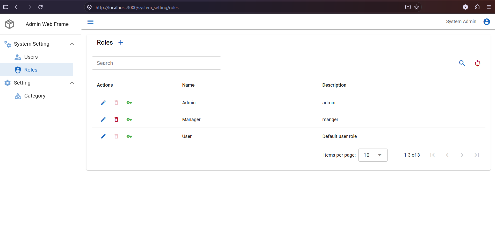

# Admin Web Frame

Admin Web တွင် အသုံးပြုလေ့ရှိသော Users၊ Roles၊ Permissions နှင့် Category များကို ပါရှိပြီးသည့် Vue frontend project ဖြစ်ပါသည်။ Backend အတွက် API ကို အသုံးပြုထားပါသည်။

## UI Preview

အောက်ပါပုံမှာ Roles list၊ drawer navigation၊ search၊ action buttons နှင့် pagination ပါဝင်သော UI ဖြစ်ပါသည်။



## Tech Stack

Version များသည် `package.json` တွင် သတ်မှတ်ထားသော dependency ranges ဖြစ်ပါသည်။ တိကျသော installed versions များကို `package-lock.json` တွင် ကြည့်နိုင်ပါသည်။

| Technology            | Version / Package            | အသုံးပြုပုံ                                                    |
| --------------------- | ---------------------------- | -------------------------------------------------------------- |
| Vue                   | `^3.5.21`                    | Vue Single File Components၊ Composition API၊ `<script setup>`  |
| JavaScript            | ES modules                   | Application logic နှင့် API services                           |
| Vuetify               | `^3.10.1`                    | Drawer၊ dialog၊ form၊ data table နှင့် responsive layout       |
| Pinia                 | `^3.0.4`                     | Login user၊ permissions၊ layout နှင့် setting state            |
| Vue Router            | `^4.5.1`                     | Page routes၊ authentication နှင့် permission guards            |
| Vite                  | `^7.1.5`                     | Development server၊ API proxy နှင့် production build           |
| Vue Toastification    | `^2.0.0-rc.5`                | Success၊ error၊ warning နှင့် info toast notifications         |
| Material Design Icons | `@mdi/font` `7.4.47`         | Navigation နှင့် action icons                                  |
| Roboto                | `@fontsource/roboto` `5.2.7` | UI font                                                        |
| Sass                  | `sass-embedded` `^1.92.1`    | Vuetify style configuration                                    |
| ESLint                | `^9.35.0`                    | JavaScript နှင့် Vue code style checks                         |
| Node.js test runner   | `node --test`                | API၊ authentication၊ permissions နှင့် menu regression tests   |
| Fetch API             | Browser built-in             | Bearer-authenticated HTTP requests၊ cancellation နှင့် timeout |

`apexcharts` နှင့် `vue3-apexcharts` dependencies များလည်း ပါဝင်ပြီး chart plugin ကို global register လုပ်ထားပါသည်။ Vue/Vuetify auto-import နှင့် font loading အတွက် Vite plugins များကို အသုံးပြုထားပါသည်။

## Features

- Login၊ Logout၊ current user information နှင့် account password change။
- Users CRUD၊ role selection၊ search နှင့် advanced filters။
- Roles CRUD နှင့် program အလိုက် Read/Write/Delete/Print
  -permission management
- Setting အောက်တွင် Category CRUD၊ search နှင့် server pagination။
- Backend မှ program/permission data အပေါ်မူတည်သော drawer navigation နှင့် access-denied page။
- Save/Delete success နှင့် API failure များအတွက် ညာဘက်အပေါ် toast notifications။

Users၊ Roles၊ Permissions နှင့် Category data များကို Lottery APIs မှ ရယူပါသည်။ Category CRUD သည် browser `localStorage` ကို မသုံးပါ။ Location module သည် လက်ရှိ browser-local persistence ကို အသုံးပြုနေပါသည်။

## Folder Structure

```text
access-inventory-fe/
├── docs/
│   └── API-CONTRACT.md             # API contract နှင့် integration notes
├── public/
│   └── favicon.ico
├── src/
│   ├── components/
│   │   ├── base/
│   │   │   ├── DataTableHelper.vue  # Server pagination/sorting၊ loading နှင့် retry
│   │   │   └── PasswordReset.vue   # Current account password change
│   │   ├── ConfirmDialog.vue       # Delete confirmation
│   │   ├── DrawerMenuItem.vue      # Recursive drawer menu rendering
│   │   └── MasterList.vue          # Shared browser-local list UI
│   ├── composables/
│   │   └── useNotification.js      # Shared vue-toastification wrapper
│   ├── default/
│   │   ├── DefaultLayout.vue       # Drawer + Appbar + View
│   │   ├── Appbar.vue
│   │   ├── Drawer.vue
│   │   └── View.vue                # Main router-view area
│   ├── models/
│   │   ├── user.js
│   │   ├── role.js
│   │   └── setting/category.js
│   ├── plugins/
│   │   ├── index.js                # Router၊ Vuetify နှင့် Toast registration
│   │   └── vuetify.js
│   ├── router/
│   │   ├── index.js                # Router initialization နှင့် route guards
│   │   └── routes.js               # Routes၊ aliases နှင့် page metadata
│   ├── services/
│   │   ├── api.js                  # Shared Fetch client နှင့် API error handling
│   │   ├── session.js              # Auth sessionStorage helpers
│   │   ├── user.service.js
│   │   ├── role.service.js
│   │   ├── programCodeService.js
│   │   └── setting/category.service.js
│   ├── stores/
│   │   ├── app.js                  # Authentication၊ identity နှင့် permissions
│   │   ├── layoutStore.js          # Drawer state
│   │   └── settingStore.js         # Browser-local Location data
│   ├── styles/
│   │   └── settings.scss
│   ├── utilities/
│   │   ├── constants.js
│   │   ├── datatable.js            # Table request/response mapping
│   │   ├── drawer.js               # Menu grouping/filtering
│   │   ├── menu.js                 # Backend menu tree construction
│   │   ├── navigation.js           # Safe redirects နှင့် landing route
│   │   └── permissions.js          # Permission matching နှင့် action checks
│   ├── views/
│   │   ├── users/
│   │   │   ├── List.vue
│   │   │   ├── Entry.vue
│   │   │   └── Search.vue
│   │   ├── role/
│   │   │   ├── List.vue
│   │   │   ├── Entry.vue
│   │   │   └── Permission.vue
│   │   ├── setting/
│   │   │   ├── Settings.vue
│   │   │   ├── category/
│   │   │   │   ├── List.vue
│   │   │   │   └── Entry.vue
│   │   │   └── location/LocationList.vue
│   │   ├── system/
│   │   │   ├── account/AccountEntry.vue
│   │   │   ├── UserList.vue         # Compatibility wrapper
│   │   │   └── Permission.vue       # Compatibility wrapper
│   │   ├── Home.vue
│   │   ├── Login.vue
│   │   ├── Logout.vue
│   │   └── Forbidden.vue
│   ├── App.vue
│   └── main.js                     # Application bootstrap နှင့် page title
├── tests/
│   ├── access-control.test.js
│   ├── category.test.js
│   └── menu.test.js
├── .env.example
├── index.html
├── package.json
├── package-lock.json
├── vite.config.mjs
├── ui.png                          # README UI screenshot
└── README.md
```

Package name သည် `admin-web-frame` ဖြစ်ပါသည်။ `@` import alias သည် `src/` ကို ရည်ညွှန်းပါသည်။

## CRUD Code Pattern

`List.vue` တွင် search၊ table၊ permissions နှင့် delete confirmation ကို ထိန်းချုပ်ပါသည်။ `Entry.vue` တွင် create/edit dialog၊ form validation နှင့် save request ကို ထိန်းချုပ်ပါသည်။ `models/` တွင် form data ပုံစံ၊ `services/` တွင် backend calls ကို ခွဲထားပါသည်။

ပုံမှန် flow သည် `List → Entry.Show(data) → Service.SaveOrUpdate() → AfterSaved → DataTable.Reload()` ဖြစ်ပါသည်။ Failure များကို toast နှင့် သက်ဆိုင်ရာ form/retry message ဖြင့် ဖော်ပြပါသည်။ Shared API client သည် `success: false` responses ကိုလည်း error အဖြစ် ကိုင်တွယ်ပါသည်။

## Getting Started

Node.js နှင့် npm လိုအပ်ပါသည်။ Vite 7 အတွက် Node.js 20.19+ သို့မဟုတ် 22.12+ ကို အသုံးပြုပါ။ Backend Api ကိုလည်း run ထားရပါမည်။

Backend Repo Url - https://github.com/yelynnpaing/ModernDotNetFourLayers-FrameWork

```powershell
npm ci
Copy-Item .env.example .env.development
npm run dev
```

`.env.development` ရှိပြီးသားဖြစ်ပါက ထပ်မံ copy မလုပ်ဘဲ လက်ရှိ configuration ကို စစ်ဆေးပါ။ Development server သည် ပုံမှန်အားဖြင့် `http://localhost:3000` တွင် run ပါသည်။

```dotenv
VITE_API_BASE_URL=/api
VITE_API_PROXY_TARGET=https://localhost:7204
```

Browser မှ `/api` requests များကို Vite development proxy က Lottery backend သို့ ပို့ပေးပါသည်။ HTTP backend ကို အသုံးပြုပါက proxy target ကို `http://localhost:5225` အဖြစ် ပြောင်းနိုင်ပါသည်။

Production တွင် `/api` အတွက် reverse proxy စီစဉ်ထားရန် သို့မဟုတ် build မလုပ်မီ `VITE_API_BASE_URL` ကို backend URL အဖြစ် သတ်မှတ်ရန် လိုအပ်ပါသည်။ Vite development proxy သည် production build တွင် မပါဝင်ပါ။

## Available Commands

| Command            | အသုံးပြုပုံ                                     |
| ------------------ | ----------------------------------------------- |
| `npm run dev`      | Development server                              |
| `npm run build`    | Production files ကို `dist/` သို့ build လုပ်ရန် |
| `npm run preview`  | Production build ကို local preview လုပ်ရန်      |
| `npm run lint`     | Code style စစ်ရန်                               |
| `npm run lint:fix` | Auto-fix လုပ်နိုင်သော lint issues ကို ပြင်ရန်   |
| `npm test`         | Automated regression tests run ရန်              |

Tests များတွင် mocked API responses ဖြင့် authentication၊ permissions၊ menu routing နှင့် Category API contracts ကို စစ်ဆေးပါသည်။ Live backend CRUD စစ်ဆေးရန် မှန်ကန်သော account နှင့် သက်ဆိုင်ရာ permissions လိုအပ်ပါသည်။

## Category API

| Method | Endpoint                        | အသုံးပြုပုံ                                                                    |
| ------ | ------------------------------- | ------------------------------------------------------------------------------ |
| GET    | `/api/category`                 | List/search၊ `start` (one-based page)၊ `length`၊ `sortBy`၊ `sortOrder`၊ `name` |
| GET    | `/api/category/getbyid?id={id}` | Edit record ရယူရန်                                                             |
| POST   | `/api/category/save`            | `{ id, name, description }`၊ `id: 0` ဖြင့် create၊ existing id ဖြင့် update    |
| DELETE | `/api/category/delete?id={id}`  | Confirmation ပြီးနောက် delete                                                  |

Category name သည် required ဖြစ်ပြီး 1–80 characters၊ description သည် optional ဖြစ်ပြီး 250 characters အထိ လက်ခံပါသည်။ Category actions များသည် Setting permissions ကို အသုံးပြုပါသည်။ API integration အသေးစိတ်အတွက် [API contract notes](./docs/API-CONTRACT.md) ကို ကြည့်ပါ။
